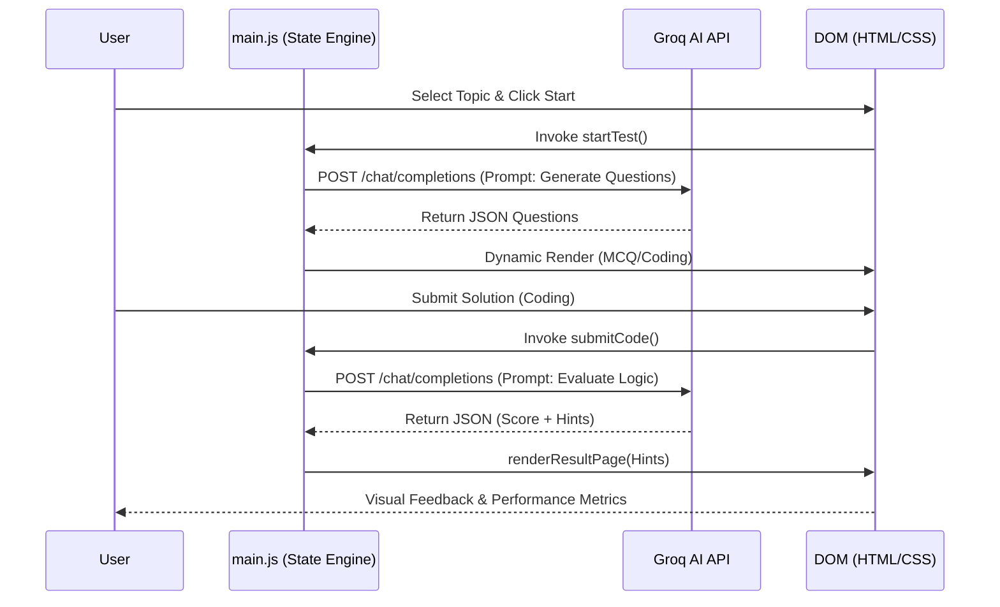

# Technical Handover: AI Mock Test Generator

This document provides a technical deep-dive into the architecture and execution flow of the AI Mock Test Generator project, designed to assist a Tech Lead or Senior Architect in reviewing the codebase.

## 🏗️ Architecture Overview

The application is a **single-page, state-driven web application** built with a "Vanilla-Plus" approach. It avoids heavy frameworks in favor of high-performance native DOM manipulation and custom state management.

- **Frontend**: HTML5, Vanilla JavaScript (ESM), and Vanilla CSS3.
- **State Management**: A centralized `state` object acts as the "Single Source of Truth," managed via reactive-style update functions.
- **AI Core**: Powered by **Groq Cloud API** (Llama 3.3 70B), handling everything from dynamic assessment synthesis to real-time code execution simulation.
- **Persistence**: API credentials and session configurations are persisted via `localStorage`.

---

## 📂 Key File Breakdown

| File | Responsibility |
| :--- | :--- |
| `client/src/frontend/index.html` | Root application shell and entry point for the Vite build system. |
| `client/src/frontend/src/main.js` | The core engine; manages state, routing, AI prompts, and component rendering. |
| `client/src/frontend/src/style.css` | The complete design system; contains all variables, glassmorphism utilities, and keyframe animations. |
| `client/src/frontend/src/data.js` | Repository of fallback mock questions and standard problem templates. |
| `client/src/frontend/src/counter.js` | Helper utility for performance-tuned counting or timing operations (if applicable). |

---

## ⚡ The "Critical Path" Flow

The main feature involves the dynamic generation and evaluation of technical assessments. Here is the step-by-step execution path:

1. **Initialization**: On load, `renderApp()` initializes the Home Page and attaches global listeners.
2. **Start Signal**: When a user clicks "Start Practice," `startTest()` is invoked.
3. **API Orchestration**: 
   - `startTest()` validates the `groqKey` in the `state`.
   - It triggers `generateAIQuestions()`, which constructs an optimized technical prompt.
   - The Groq API returns a JSON-formatted array of questions.
4. **Contextual Rendering**: Depending on `state.testType`, either `renderMCQQuestion()` or `renderCodingProblem()` is called to populate the DOM.
5. **Execution Simulation (Coding Only)**:
   - When the user clicks "Run Code," `runCode()` sends the raw code to Groq.
   - The AI acts as a **Raw Terminal**, returning only the execution logs or ASCII tables.
6. **Evaluation & Result**:
   - On submission, `submitCode()` sends a "Senior Architect" evaluation prompt to Groq.
   - The AI returns a structured JSON (Score, Passed/Failed, Hint).
   - `showResultPage()` aggregates this data and displays the final performance metrics and AI Insights.

---

## 📊 Data Flow Diagram

---

## 🧠 Complexity Analysis: AI-Powered Code Simulation

The most sophisticated logic in this project is the **LLM-as-a-Runtime** implementation found in the `runCode()` and `submitCode()` functions.

### How it works:
Unlike traditional online compilers that use Docker containers or sandboxed environments, this project uses **Instruction-Tuned Prompt Engineering** to simulate a technical runtime.

1. **The "Terminal" Persona**: In `runCode()`, we use a specific system rule to strip the LLM of its "conversational" nature. We force it to act as a raw binary, producing zero reasoning text and only literal technical output (like ASCII tables for SQL).
2. **Temperature Calibration**: We set the LLM temperature to `0.0`. This is critical because code execution must be **deterministic**. By zeroing the temperature, we ensure the AI doesn't "hallucinate" different outputs for the same logic.
3. **The Evaluation Logic**: In `submitCode()`, the AI transitions from a "Terminal" to a "Senior Developer." It performs a deep logic check—looking for edge case handling and time complexity compliance—and returns a structured JSON object. This allows the frontend to programmatically update the `state.codingResults` without needing manual string parsing.

This approach eliminates the need for expensive backend infrastructure while providing a highly realistic, multi-language coding experience.
