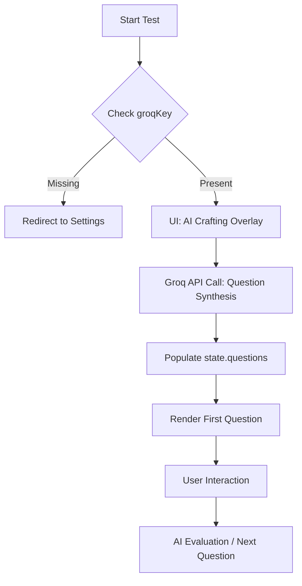

# Technical Handover 2: Deep Dive into AI & State

This document extends the initial architecture overview, focusing on the sophisticated prompt engineering and state-driven UI transitions.

## 🧠 AI Prompt Engineering Strategy

The core of the "Intelligence" layer resides in how we instruct the Groq LLM. We use three primary "Personas":

1.  **SME Assessment Designer**: Used in `generateAIQuestions`. Instructions focus on valid JSON structure, technical accuracy, and difficulty-appropriate distractors (for MCQs).
2.  **Raw Terminal Runtime**: Used in `runCode`. Instructions use strict system rules to zero out conversational filler, returning only raw console logs or ASCII tables.
3.  **Senior Code Reviewer**: Used in `submitCode`. Instructions mandate a JSON-only response with qualitative metrics (Score, Passed Boolean, and a "Hint" string for coaching).

## 📊 Advanced State Management

The application utilizes a reactive state pattern without the overhead of external libraries.

### State Transitions
When `state.currentQuestion` changes:
- `renderMCQQuestion()` or `renderCodingProblem()` re-evaluates the entire UI slice.
- DOM elements are targeted by ID for pinpoint updates, minimizing full-page reflows.
- `updateMCQDots()` provides a breadcrumb trail for the user, calculating classes dynamically based on `state.answers`.

## 🛠️ Planned Database Integration (MongoDB)

To move beyond `localStorage`, we are transitioning to a Mongoose-based data layer.

### Proposed Schema Structure:
- **Questions Collection**: Stores generated content (Category, Topic, Difficulty, SME Name).
- **Submissions Collection**: Stores student performance (Score, Time Taken, Hints provided).

## 🚀 The Execution Pipeline

## 🔍 Complexity Analysis: The "Coaching Loop"

The `submitCode` function represents the highest logic complexity:
1. **Double-Pass Evaluation**: It isn't just checking string equality. It asks the AI to "Understand" the solution.
2. **Hint Synthesis**: The AI must identify *why* it failed (e.g., "Off-by-one error") without providing the fix, maintaining the educational value of the practice.
3. **State Sync**: Results are pushed to `state.codingResults` and `state.codingHints` simultaneously, allowing the Result Page to render a mapped view of the entire session history.
